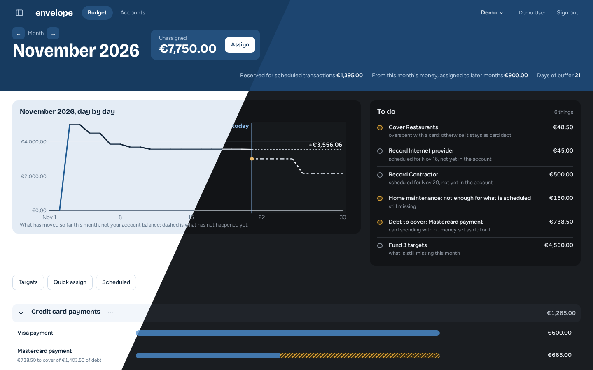
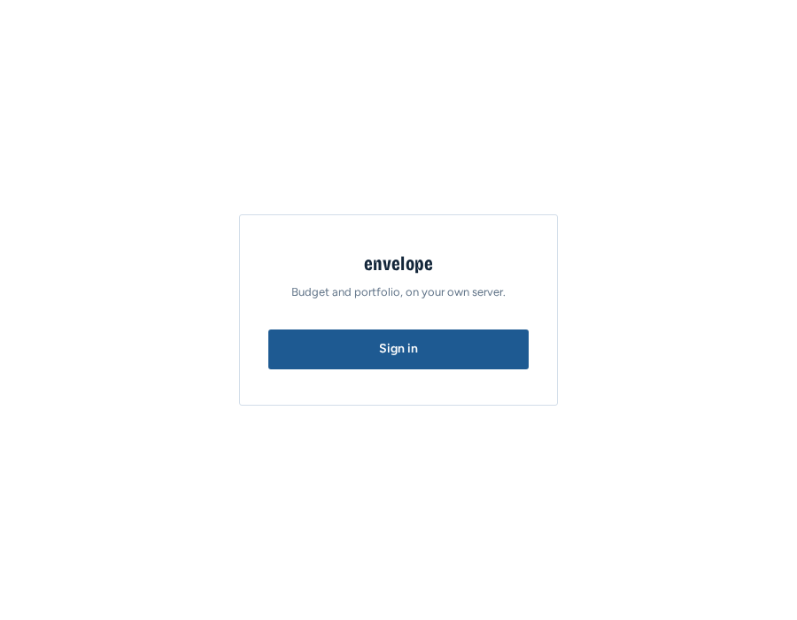
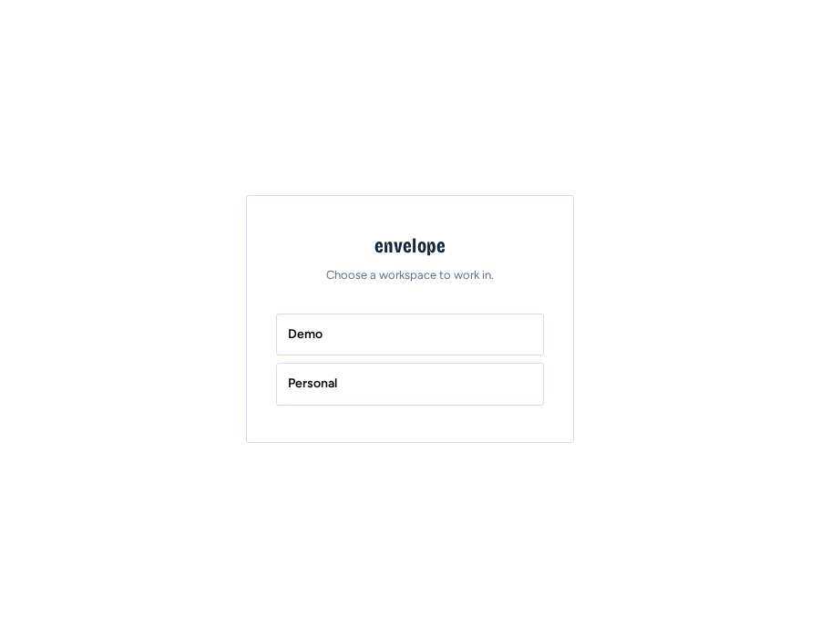
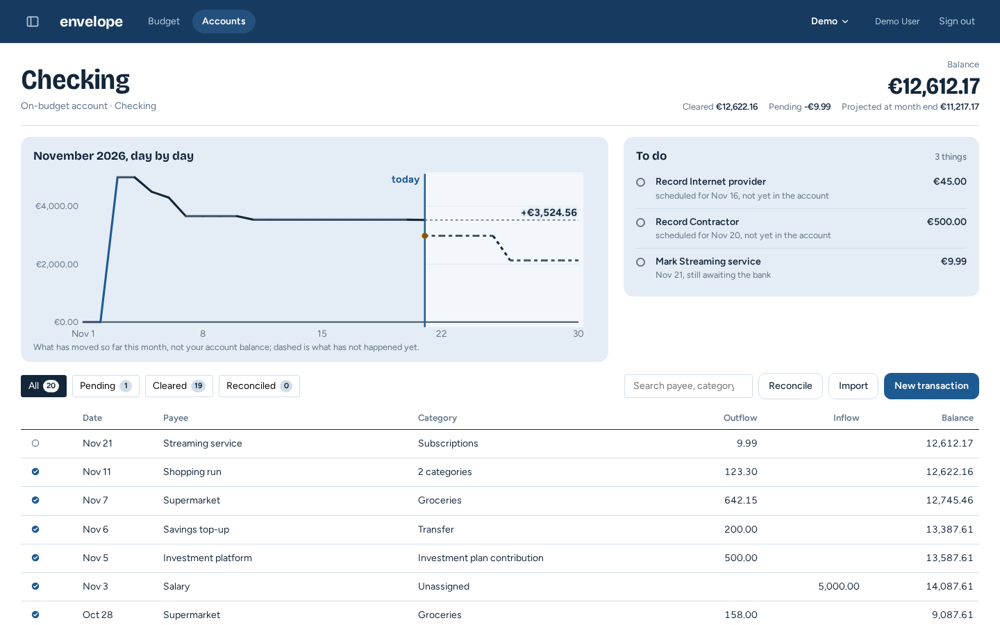
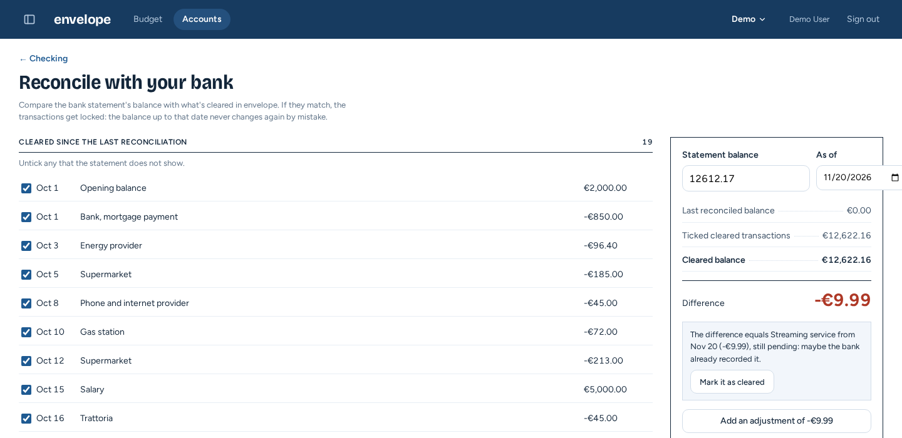
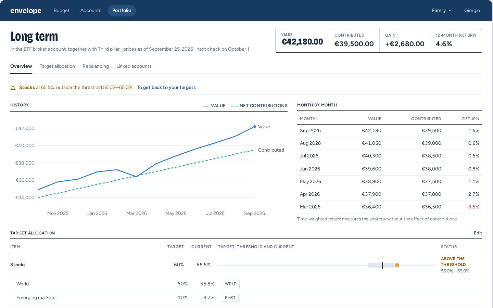
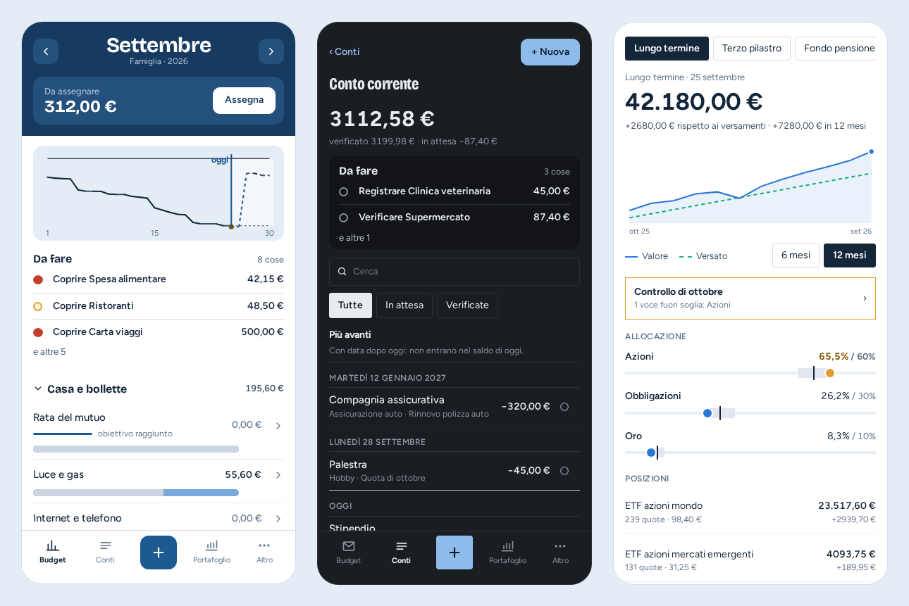
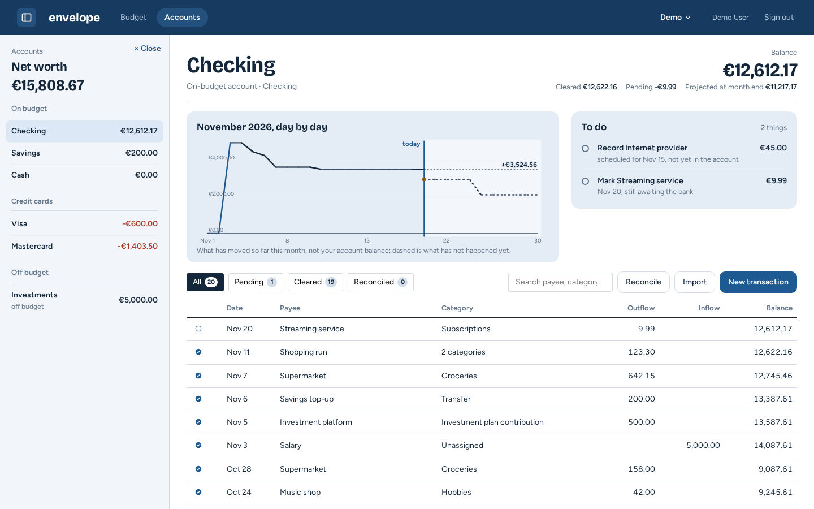

# envelope

**A self-hosted budget and investment app for households.** Budget the money you already have, keep your portfolios on the targets you chose, and keep your data on your own server.

[](https://github.com/aramilialon/project_envelope/actions/workflows/ci.yml)



> `envelope` is a code name. The app is being built: the backend comes first (milestone 0.1.x), then the web app. Most screens on this page come from the real running app, in English; the portfolio and the phone screens come from the [interactive mockups](docs/ux/mockups/), which show the Italian translation. Every screenshot exists in a light and a dark version ([docs/ux/screenshots/](docs/ux/screenshots/)); the gallery below shows the one that matches your browser's theme.

## What it does

**Envelope budgeting.** Money that comes in stays *unassigned* until you assign it to categories, and you only ever assign money you already have.

- Categories with rollover, credit cards with their own payment category, overspending that is handled differently for cash and for cards.
- Targets for monthly bills, for a sum by a date, for expenses that repeat every few months, and for a balance to keep.
- Import of bank statements (CSV, OFX, QIF, CAMT.053) with duplicate detection, and reconciliation with the bank balance.
- Days of buffer, and instant notifications when a category goes negative.

**Portfolios.** Record your trades; envelope derives positions, value and month-by-month performance.

- Multi-level target allocation with a threshold for each item, and several portfolios in the same brokerage account.
- Mechanical rebalancing: contributions only, full, or just back to the edge of the threshold.
- It never suggests what to buy and never judges your choices: it only computes what your own targets require.

**Your data.**

- Self-hosted, multi-user from day one: a family shares a workspace, each member with a role.
- Full export at any time. Every balance can be rebuilt from the recorded transactions.
- Web and mobile, offline first on the phone; optional end-to-end encryption is planned as a future module.

## A closer look

| Sign in ([mockup](docs/ux/mockups/sign-in.html)) | Choosing a workspace, first visit with several |
| --- | --- |
| <a href="docs/ux/screenshots/sign-in-light.png"><picture><source media="(prefers-color-scheme: dark)" srcset="docs/ux/screenshots/sign-in-dark.png"></picture></a> | <a href="docs/ux/screenshots/workspace-picker-light.png"><picture><source media="(prefers-color-scheme: dark)" srcset="docs/ux/screenshots/workspace-picker-dark.png"></picture></a> |
| **Account register** ([mockup](docs/ux/mockups/account-register.html)) | **Reconciliation** ([mockup](docs/ux/mockups/import-reconciliation.html)) |
| <a href="docs/ux/screenshots/account-register-light.png"><picture><source media="(prefers-color-scheme: dark)" srcset="docs/ux/screenshots/account-register-dark.png"></picture></a> | <a href="docs/ux/screenshots/reconciliation-light.png"><picture><source media="(prefers-color-scheme: dark)" srcset="docs/ux/screenshots/reconciliation-dark.png"></picture></a> |
| **Portfolio** ([mockup](docs/ux/mockups/portfolio.html)) | **On the phone** |
| <a href="docs/ux/screenshots/portfolio-light.png"><picture><source media="(prefers-color-scheme: dark)" srcset="docs/ux/screenshots/portfolio-dark.png"></picture></a> | <a href="docs/ux/screenshots/phones-mixed.png"></a> |
| **Accounts panel** ([mockup](docs/ux/mockups/accounts-panel.html)) | |
| <a href="docs/ux/screenshots/accounts-panel-light.png"><picture><source media="(prefers-color-scheme: dark)" srcset="docs/ux/screenshots/accounts-panel-dark.png"></picture></a> | |

The portfolio and the phone screens come from the mockups, in Italian (the portfolio has no screen in the app yet); every other screenshot is from the real running app, in English, over the demo workspace (`scripts/README.md`, "Reference screenshots"). "Choose a workspace" has no dedicated full-page mockup yet (`docs/ux/mockups/settings-first-run.html` only draws the sidebar's own switcher).

## Principles

- **Only money that has arrived.** The budget assigns money already in the accounts, never future income.
- **Your rules, not advice.** Targets, thresholds and rebalancing rules are yours; the app does the arithmetic.
- **Always verifiable.** Amounts are integers in minor units, and the money in the budget always matches the money in the accounts: the core's tests prove it on hundreds of random histories.
- **The data belongs to you.** No tracking, no selling of data, and a self-hosted install talks only to the services you configure.

## Status and roadmap

| Milestone | Contents | Status |
| --- | --- | --- |
| 0.1.0 – 0.1.2 | API skeleton, database schema, Row-Level Security per workspace, authentication with Keycloak (OpenID Connect) | Released |
| 0.1.3 | Budget API | Released |
| 0.1.4 | Import | Released |
| 0.1.5 | Queue and notifications | Released |
| 0.1.6 | Offline sync | Released |
| 0.1.7 | Web app | Released |
| 0.1.8 | A real month of a household budget run with the app alone | Released |
| 0.2.x | Portfolios, prices, allocation and rebalancing | In progress |
| 0.2.8 | AI assistants through a local, read-only MCP server ([ADR 0014](docs/adr/0014-assistant-access-through-mcp.md)) | Planned |
| 0.3.x | Mobile app | Planned |
| 0.4.0 | Self-hosting packaging: Docker images, a production install guide, Keycloak in production mode with multi-factor authentication, rate limiting, backups | Planned |
| 0.4.1 – 0.4.2 | Remote assistant access over the internet, assistant drafts confirmed in the app | Planned |

The complete roadmap, including what comes after 1.0.0, is in the [design document](docs/design.md#roadmap); changes are listed in the [changelog](CHANGELOG.md).

## Getting started

Everything from a fresh Debian 13 virtual machine to the first test run is in [docs/getting-started.md](docs/getting-started.md), with an Ansible playbook that prepares the machine for you. That setup is for development only: there is no production install yet. Docker images, a production install guide and an internet-ready Keycloak come with milestone 0.4.0 (issues [#153](https://github.com/aramilialon/project_envelope/issues/153) and [#157](https://github.com/aramilialon/project_envelope/issues/157)). With the tools already installed:

```bash
pnpm install
pnpm test
```

## Repository layout

| Folder | Contents |
| --- | --- |
| `packages/core` | Pure domain logic: money, months, budget month, credit cards, transaction aggregation. No network or database |
| `apps/api` | The server: Fastify, PostgreSQL through plain SQL, Keycloak for sign-in |
| `apps/web` | The browser app: Vite, React, a PWA shell so far |
| `apps/` | Next: `mobile` (Expo) |
| `infra/` | `docker-compose` for local development (PostgreSQL, Keycloak) and the Ansible playbook for the development machine |
| `docs/` | Design document, getting started, how-to guides, decision records, glossary, interface mockups |
| `scripts/` | GitHub setup (labels, milestones, protected main), Git hooks, the Keycloak realm bootstrap, and a demo data seed (`scripts/README.md`) |

## Documentation

- [Design document](docs/design.md): vision, features, architecture, interface, roadmap and decisions
- [Documentation index](docs/README.md): getting started, how-to guides, decision records, glossary
- [Interface mockups](docs/ux/mockups/): download the repository and open them in a browser

## Contributing

Every change reaches `main` through a pull request, with commit messages and titles in the form `type(scope): description`. The workflow is described in [docs/how-to/work-with-issues-and-pull-requests.md](docs/how-to/work-with-issues-and-pull-requests.md).

Code, comments, documentation and commit messages are in English. The interface is translatable: English is the source language and Italian the first complete translation ([ADR 0004](docs/adr/0004-internationalization.md)).

### Dependency overrides

A security fix is taken by upgrading the direct dependency. Only when no release of it pulls the patched version does the root `package.json` force one through `pnpm.overrides`; JSON has no comments, so each override is explained here, and removed once its parent catches up:

| Override | Why |
| --- | --- |
| `workbox-build>glob`: `^14.0.2` | `workbox-build` 7.4.1, the latest, used by `vite-plugin-pwa` to list the files the service worker precaches at build time, asks for `glob` 11, which is affected by an AbortSignal cancellation bypass (fixed in 14.0.2) and pulls `minimatch` 10, affected by a potential denial of service through pattern expansion ("globparts amplification") (fixed in 11.0.1). `glob` 14 depends on `minimatch` 11, so this one override fixes both. `workbox-build` only calls `globSync` with `cwd`, `follow` and `ignore`, which `glob` 14 keeps. Build-time only: nothing of it ships in the app. Remove it when `workbox-build` depends on `glob` 14.0.2 or later. |

The npm `undici` package is only a test dependency (under `jsdom`). The API's outgoing HTTP (the JWKS fetch) uses the `undici` built into Node.js, so keeping Node.js 24 on its latest patch release is what covers `undici` fixes for the API, not the npm package.

## License

[AGPL-3.0](LICENSE). Third-party fonts and other bundled assets keep their own licenses: see [THIRD-PARTY-NOTICES.md](THIRD-PARTY-NOTICES.md).
